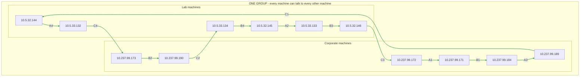
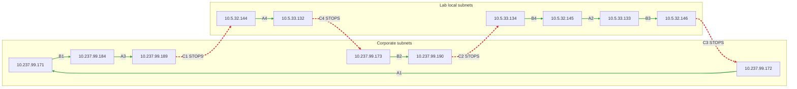
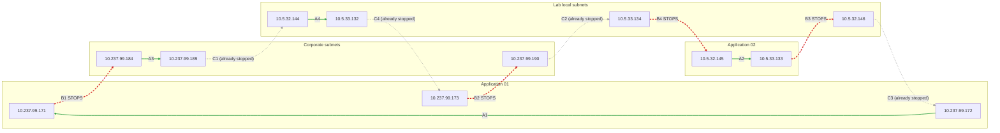

# iPerf settings

## Blueprint 1 - intra vrf contract

All 12 machines are in one group and can talk to each other.

```
10.5.32.144
10.5.32.145
10.5.32.146

10.5.33.132
10.5.33.133
10.5.33.134

10.237.99.171
10.237.99.172
10.237.99.173

10.237.99.184
10.237.99.189
10.237.99.190
```

### Expected flows in Blueprint 1

Everything is in one group, so all 12 streams work. The Corporate and Lab boxes are only there so the layout matches Blueprint 2 and 3. They are not separate groups here. Green solid lines are streams that work. The arrow points from client to server.



Result: 12 of 12 streams up.

## Blueprint 2 - grouped by subnets

### Corporate subnets

```
10.237.99.171
10.237.99.172
10.237.99.173

10.237.99.184
10.237.99.189
10.237.99.190
```

### Lab local subnets

```
10.5.32.144
10.5.32.145
10.5.32.146

10.5.33.132
10.5.33.133
10.5.33.134
```

### Expected flows in Blueprint 2

Machines can only talk inside their own group. Green solid lines still work. Red dashed lines stop. The arrow points from client to server.



Result: C1 to C4 stop because they cross between Corporate and Lab. 8 of 12 streams up.

## Blueprint 3 - grouped by applications

Three machines have moved group compared with the first draft so that every Blueprint 3 group sits inside a single Blueprint 2 group. Each step is then strictly tighter than the one before. Without this, `10.5.32.145 -> 10.237.99.172` would be blocked in v2 and allowed again in v3, which weakens the message.

| Machine | Draft group | New group |
|---|---|---|
| `10.237.99.171` | Corporate subnets | Application 01 |
| `10.5.32.145` | Application 01 | Application 02 |
| `10.237.99.189` | Application 02 | Corporate subnets |

### Application 01

```
10.237.99.171
10.237.99.172
10.237.99.173
```

### Application 02

```
10.5.32.145
10.5.33.133
```

### Corporate subnets

```
10.237.99.184
10.237.99.189
10.237.99.190
```

### Lab local subnets

```
10.5.32.144
10.5.32.146

10.5.33.132
10.5.33.134
```

### Expected flows in Blueprint 3

Machines can only talk inside their own group. Green solid lines still work. Red dashed lines stop. C1 to C4 already stopped in Blueprint 2 and stay stopped. B1 to B4 are the new ones that stop. The arrow points from client to server.



Result: B1 to B4 stop because they cross between groups. Only A1 to A4 are left. 4 of 12 streams up.

## Stream plan

There are 12 streams. Start them once while Blueprint 1 is applied and leave them running through v2 and v3.

Every stream is TCP at 1 Mbit/s with a unique server port per stream (see the Port column). Each host runs exactly one server and one client, all in the foreground, so every stream prints to a console on both ends. A blocked stream shows `0.00 bits/sec` and retransmits on the client console. A stream that is still allowed keeps showing about 1 Mbit/s.

| ID | Client | Server | Port | v1 | v2 | v3 | Why |
|---|---|---|---|---|---|---|---|
| A1 | `10.237.99.172` | `10.237.99.171` | 5201 | up | up | up | App 01 to App 01 |
| A2 | `10.5.32.145` | `10.5.33.133` | 5202 | up | up | up | App 02 to App 02, across lab subnets |
| A3 | `10.237.99.184` | `10.237.99.189` | 5203 | up | up | up | Corporate to Corporate |
| A4 | `10.5.32.144` | `10.5.33.132` | 5204 | up | up | up | Lab to Lab, across lab subnets |
| B1 | `10.237.99.171` | `10.237.99.184` | 5211 | up | up | **down** | App 01 to Corporate |
| B2 | `10.237.99.173` | `10.237.99.190` | 5212 | up | up | **down** | App 01 to Corporate |
| B3 | `10.5.33.133` | `10.5.32.146` | 5213 | up | up | **down** | App 02 to Lab, across lab subnets |
| B4 | `10.5.33.134` | `10.5.32.145` | 5214 | up | up | **down** | Lab to App 02, across lab subnets |
| C1 | `10.237.99.189` | `10.5.32.144` | 5221 | up | **down** | down | Corporate to Lab |
| C2 | `10.237.99.190` | `10.5.33.134` | 5222 | up | **down** | down | Corporate to Lab |
| C3 | `10.5.32.146` | `10.237.99.172` | 5223 | up | **down** | down | Lab to Corporate |
| C4 | `10.5.33.132` | `10.237.99.173` | 5224 | up | **down** | down | Lab to Corporate |

Summary of what you will see:

- **v1:** 12 of 12 streams up.
- **v2:** C1 to C4 stop. 8 of 12 up.
- **v3:** B1 to B4 also stop. 4 of 12 up (A1 to A4).

## Starting all the servers from the jumphost

`iperf-servers.sh` in this folder starts an `iperf3` server on all 12 machines over SSH, so you only need to start the clients by hand. Copy it to the jumphost and run:

```
SSH_USER=<your-login> ./iperf-servers.sh start
```

Then check them, and stop them at the end:

```
./iperf-servers.sh status
./iperf-servers.sh stop
```

The script starts all 12 servers in parallel, on the port listed for each host in the stream table below. `start` does not kill anything, and it skips a host if the right port is already listening, so it is safe to run twice. It only reports OK when the port is really listening. The servers run in the background and write to `/tmp/iperf3-server-<port>.log` on each machine. To watch one, run `tail -f /tmp/iperf3-server-<port>.log` on that machine. To clear everything, run `./iperf-servers.sh stop` or `killall iperf3` on the machines. The script uses your SSH keys or ssh-agent, so the jumphost must already be able to log in to the machines without a password prompt. If you use this script, you do not need Terminal 1 in the sections below.

## Starting the clients from the jumphost

`iperf-clients.sh` in this folder runs the clients over SSH and shows their output in your jumphost session. The traffic still goes from client machine to server machine. Start the servers first.

The simplest way to run the demo is to start the clients in the background and watch them in the dashboard. You do not need `tmux` for this:

```
SSH_USER=<your-login> ./iperf-servers.sh start
SSH_USER=<your-login> ./iperf-clients.sh start
SSH_USER=<your-login> ./iperf-dashboard.py
```

All the commands:

```
SSH_USER=<your-login> ./iperf-clients.sh list
SSH_USER=<your-login> ./iperf-clients.sh start
SSH_USER=<your-login> ./iperf-clients.sh A4
SSH_USER=<your-login> ./iperf-clients.sh all
SSH_USER=<your-login> ./iperf-clients.sh tmux
SSH_USER=<your-login> ./iperf-clients.sh stop
```

- `list` shows the 12 streams.
- `start` starts all 12 clients in the background and returns. It prints one line per stream, skips any that are already running, and writes each client's output to `/tmp/iperf3-client-<ID>.log` on its machine. The clients keep running if you close your SSH session. Use the dashboard to watch them.
- `A4` runs one stream in the foreground. Replace `A4` with any stream ID. Ctrl+C stops it.
- `all` runs all 12 in one session. Each line starts with its stream ID, such as `[B3]`. Ctrl+C stops all of them.
- `tmux` runs all 12 in a tiled `tmux` window, one tile per stream. This is the easiest way to watch which ones stop. It needs `tmux` on the jumphost (`sudo apt install -y tmux`). Detach with Ctrl+B then D and re-attach with `tmux attach -t iperf-clients`.
- `stop` stops every client on every machine.

Set `DURATION=<seconds>` for a time-limited test. The default is to run until you stop it.

## Live graph of the streams

`iperf-dashboard.py` draws one row per stream with a timeline. The timeline starts at the left when you start the dashboard and grows to the right, one cell per second. Green means data arrived and red means 0 bytes arrived. When it reaches the right-hand edge it scrolls left. A time axis under the streams shows the clock time of each column. It also shows UP or DOWN with how long it has been down, and a count of streams up. Only data that arrives after you start the dashboard is drawn, so start it before you apply a blueprint.

It reads the iperf3 server logs on the receiving machines, so it shows a drop within a second or two. The client consoles can lag behind, because iperf3 on the client counts what it has written to the socket, not what has been delivered. Run it on the jumphost, in a wide terminal, after the servers and clients are started:

```
SSH_USER=<your-login> ./iperf-dashboard.py
```

Press Ctrl+C to quit. It does not stop the streams. It needs only `python3`, which is already on the jumphost. If you change the streams, update the list at the top of the script, which is the same list as in `iperf-clients.sh`.

## How to run it

Open two SSH sessions to every host, or one session with two `tmux` panes:

- **Terminal 1** runs the server. It prints one line per second for the stream coming in.
- **Terminal 2** runs the client. It prints one line per second for the stream going out.

Start order:

1. Start Terminal 1 (server) on all 12 hosts.
2. Start Terminal 2 (client) on all 12 hosts.
3. Check that all 12 client consoles show about 1 Mbit/s before you apply v2.

Notes:

- Nothing is backgrounded. Every command stays in the foreground and keeps printing until you press Ctrl+C.
- `-t 0` makes the client run until you stop it.
- A blocked TCP stream gives up after roughly 15 minutes (`net.ipv4.tcp_retries2`). If you want to re-apply v1 and show the streams recovering, do it within that window, or raise the sysctl on the client hosts.
- The VMs' own firewalls must allow TCP 5201 to 5204, 5211 to 5214 and 5221 to 5224.

## Commands per host

### 10.5.32.144 (Lab)

Terminal 1, server for C1 from `10.237.99.189`:

```
iperf3 -s -p 5221 -i 1
```

Terminal 2, client A4 to `10.5.33.132`:

```
iperf3 -c 10.5.33.132 -p 5204 -t 0 -b 1M -l 1K -i 1
```

### 10.5.32.145 (App 02)

Terminal 1, server for B4 from `10.5.33.134`:

```
iperf3 -s -p 5214 -i 1
```

Terminal 2, client A2 to `10.5.33.133`:

```
iperf3 -c 10.5.33.133 -p 5202 -t 0 -b 1M -l 1K -i 1
```

### 10.5.32.146 (Lab)

Terminal 1, server for B3 from `10.5.33.133`:

```
iperf3 -s -p 5213 -i 1
```

Terminal 2, client C3 to `10.237.99.172`:

```
iperf3 -c 10.237.99.172 -p 5223 -t 0 -b 1M -l 1K -i 1
```

### 10.5.33.132 (Lab)

Terminal 1, server for A4 from `10.5.32.144`:

```
iperf3 -s -p 5204 -i 1
```

Terminal 2, client C4 to `10.237.99.173`:

```
iperf3 -c 10.237.99.173 -p 5224 -t 0 -b 1M -l 1K -i 1
```

### 10.5.33.133 (App 02)

Terminal 1, server for A2 from `10.5.32.145`:

```
iperf3 -s -p 5202 -i 1
```

Terminal 2, client B3 to `10.5.32.146`:

```
iperf3 -c 10.5.32.146 -p 5213 -t 0 -b 1M -l 1K -i 1
```

### 10.5.33.134 (Lab)

Terminal 1, server for C2 from `10.237.99.190`:

```
iperf3 -s -p 5222 -i 1
```

Terminal 2, client B4 to `10.5.32.145`:

```
iperf3 -c 10.5.32.145 -p 5214 -t 0 -b 1M -l 1K -i 1
```

### 10.237.99.171 (App 01)

Terminal 1, server for A1 from `10.237.99.172`:

```
iperf3 -s -p 5201 -i 1
```

Terminal 2, client B1 to `10.237.99.184`:

```
iperf3 -c 10.237.99.184 -p 5211 -t 0 -b 1M -l 1K -i 1
```

### 10.237.99.172 (App 01)

Terminal 1, server for C3 from `10.5.32.146`:

```
iperf3 -s -p 5223 -i 1
```

Terminal 2, client A1 to `10.237.99.171`:

```
iperf3 -c 10.237.99.171 -p 5201 -t 0 -b 1M -l 1K -i 1
```

### 10.237.99.173 (App 01)

Terminal 1, server for C4 from `10.5.33.132`:

```
iperf3 -s -p 5224 -i 1
```

Terminal 2, client B2 to `10.237.99.190`:

```
iperf3 -c 10.237.99.190 -p 5212 -t 0 -b 1M -l 1K -i 1
```

### 10.237.99.184 (Corporate)

Terminal 1, server for B1 from `10.237.99.171`:

```
iperf3 -s -p 5211 -i 1
```

Terminal 2, client A3 to `10.237.99.189`:

```
iperf3 -c 10.237.99.189 -p 5203 -t 0 -b 1M -l 1K -i 1
```

### 10.237.99.189 (Corporate)

Terminal 1, server for A3 from `10.237.99.184`:

```
iperf3 -s -p 5203 -i 1
```

Terminal 2, client C1 to `10.5.32.144`:

```
iperf3 -c 10.5.32.144 -p 5221 -t 0 -b 1M -l 1K -i 1
```

### 10.237.99.190 (Corporate)

Terminal 1, server for B2 from `10.237.99.173`:

```
iperf3 -s -p 5212 -i 1
```

Terminal 2, client C2 to `10.5.33.134`:

```
iperf3 -c 10.5.33.134 -p 5222 -t 0 -b 1M -l 1K -i 1
```

## What you will see on the console

A working stream prints a line every second with about 1 Mbits/sec:

```
[  5]   3.00-4.00   sec   128 KBytes  1.05 Mbits/sec    0   64.2 KBytes
```

A blocked stream on the client drops to `0.00 bits/sec` and shows retransmits (`Retr`):

```
[  5]  15.00-16.00  sec  0.00 Bytes  0.00 bits/sec    3   1.41 KBytes
```

On the server, the matching line also drops to `0.00 bits/sec`.
